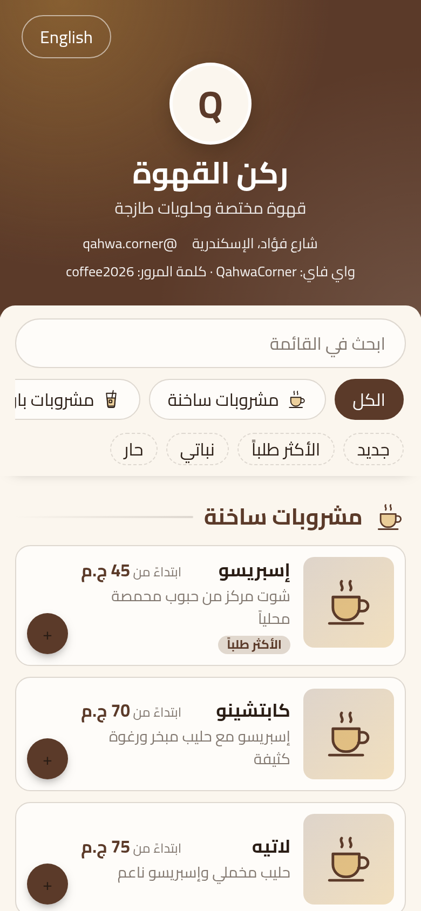
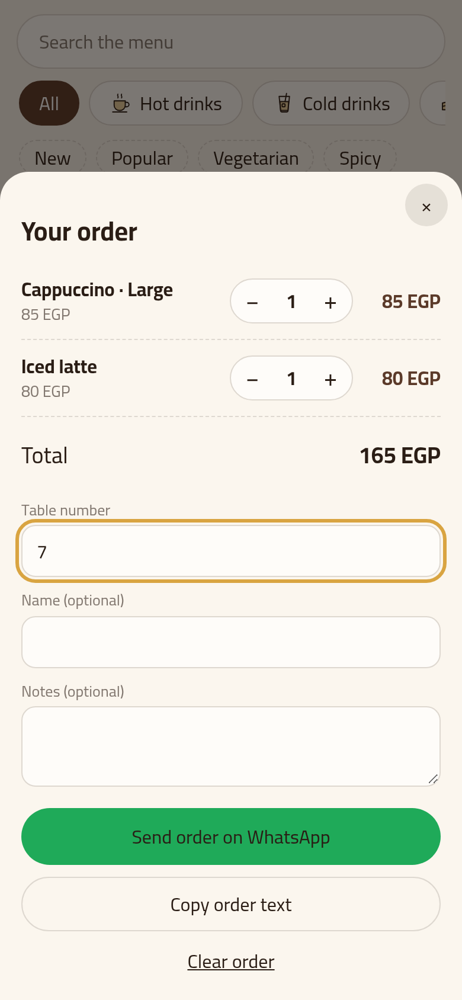
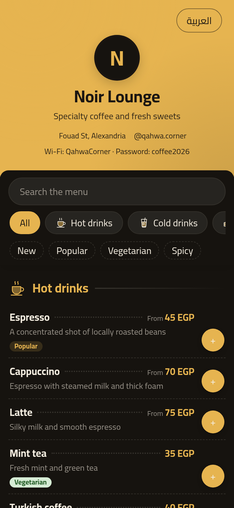

<p align="center"></p>

<h1 align="center">Menyu</h1>
<p align="center"><b>White-label QR menu builder for cafes and restaurants.</b><br>
Arabic and English with real RTL. Your logo, your colors, your currency. No server, no sign-up, free.</p>

<p align="center"><a href="https://yousefkhames.github.io/menyu/"><b>Open the live builder</b></a> ·
<a href="https://yousefkhames.github.io/menyu/menu.html">See a customer menu</a></p>

<p align="center">



</p>

## The pitch

A cafe owner wants a menu on a QR code, in two languages, in their own colors, today. Menyu is one folder of static files. You open the builder, type the shop name, drop in a logo, pick colors, add the items, and print the QR. Customers scan, browse in Arabic or English, tap items into an order, and send it to the shop on WhatsApp with their table number already filled in.

Built so one codebase can be re-branded and handed to any shop. All branding lives in a settings screen and in one exportable `menu.json`.

## Features

**For the shop owner (builder)**
- Brand settings: shop name and tagline in Arabic and English, logo upload (resized in the browser), 6 ready palettes plus custom colors, corner style, card or classic-list layout. A contrast check warns when text is hard to read.
- Currency symbol in both languages, symbol before or after, decimals, Latin or Arabic-Indic digits.
- Categories and items: names and descriptions in both languages, photo upload, 15 built-in line icons (no photo needed), tags (new, popular, vegetarian, spicy, gluten free), sizes with their own prices, sold-out switch, hide, duplicate, reorder, delete with undo.
- Bulk price change (for example +10%, rounded to the nearest 5) for one category or all.
- "Check before printing" list: missing translations, zero prices, empty categories, missing WhatsApp number, low contrast.
- QR code for the menu link (SVG and PNG download) and printable table cards: one QR per table that pre-fills the table number in the order.
- Export a standalone `menu.html` (one file, fonts included, works offline) or `menu.json` (all settings and items). Import a `menu.json` back.
- Undo (button and Ctrl+Z), live phone preview next to the editor, builder UI in Arabic or English.

**For customers (menu page)**
- Opens in the shop's default language, one tap to switch. Full RTL layout in Arabic.
- Search that understands Arabic spelling variants (أ/ا, ة/ه, diacritics), category chips, tag filters.
- Item sheet with sizes and quantity, order list with quantities, total, table number, name and notes.
- Send the order as a WhatsApp message (built from the shop number) or copy the text.
- Works offline after the first visit (service worker).

## How to hand it to a new shop

1. Fork this repo (or download it) and enable GitHub Pages, or upload the folder to any static host.
2. Open `index.html`, go to **Brand**, set the name, logo, colors, currency and WhatsApp number.
3. Add categories and items in **Menu**.
4. In **Share**, export `menu.json` and commit it as `menu.json` at the repo root. The customer page `menu.html` reads it. Or export the standalone `menu.html` and put that file on the shop hosting.
5. Put the public menu link in **Share**, download the QR, or print the table cards.

## Tech

- Plain HTML, CSS and JavaScript. No framework, no build step, no backend, no tracking, no network calls at runtime.
- Data lives in `localStorage` (builder) and `menu.json` / embedded JSON (customers).
- Cairo font bundled (SIL OFL). QR generation by [qrcode-generator](https://github.com/kazuhikoarase/qrcode-generator) (MIT), vendored in `js/vendor`. See `THIRD_PARTY.md`.
- Imported JSON is validated and cleaned (`normalizeData`): colors, URLs, tags, images and numbers are sanitized, and user text is always inserted as text, never as HTML.

## Tests

```bash
npm install        # only playwright-core and jsqr, for the tests
npm test
```

- `tests/unit.test.js`: 21 unit tests for the logic (prices, colors and contrast, Arabic search, validation of hostile input, cart and order message, WhatsApp number handling, audit, bulk prices, QR matrix, standalone export).
- `tests/e2e.js`: a 36-step click-through in real Chrome (via playwright-core): add and edit categories and items with photo upload, undo, bulk prices, rebrand and see it in the live preview, generate a QR and decode it back with a QR reader, export and re-import, export the standalone file and open it with the network blocked, place an order in the customer menu and check the WhatsApp link, offline reload, mobile and Arabic layouts without horizontal overflow, and no console errors.
- `tests/screens.js` regenerates the screenshots in `docs/`.

## Honest limits

- It is a menu and an order message, not a POS. Orders are sent as a WhatsApp text to the shop. There is no kitchen screen, no payments, no order history.
- There is no server, so edits do not sync between devices. The builder saves in the browser it was used in. Export `menu.json` to back up or move to another device. Clearing browser data erases the builder data (the exported files are the safe copy).
- Customers see a menu only after you publish it (`menu.json` in the repo, or the standalone `menu.html`). Changing items in the builder does not change the live menu until you export and upload again.
- Photos are stored as small compressed images inside `localStorage`, which is limited to about 5 MB per browser. A menu with many large photos can fill it. The builder tells you when saving fails.
- The WhatsApp order opens `wa.me` and needs the shop number in international format or a local number plus the country code in settings.
- Built-in icons are simple line drawings. Photos look better.
- The Arabic and English UI text was written by the author. Have a native speaker proof-read it for your shop.
- Tested in Chrome only (desktop and mobile emulation). Other modern browsers should work, but they were not tested.

## License

MIT. See `LICENSE`.

## Round 2 review notes
- "Copy order text" now reports a failure honestly when the browser blocks copying (it used to say "Copied" regardless).
- Reviewed and already solid: data normaliser on load/import, undo after import, country-code WhatsApp links, empty states.
- Limit: WhatsApp links are only verified as generated URLs.
- Offline: a service worker precaches the app shell and the bundled fonts (added in round 2 review).
