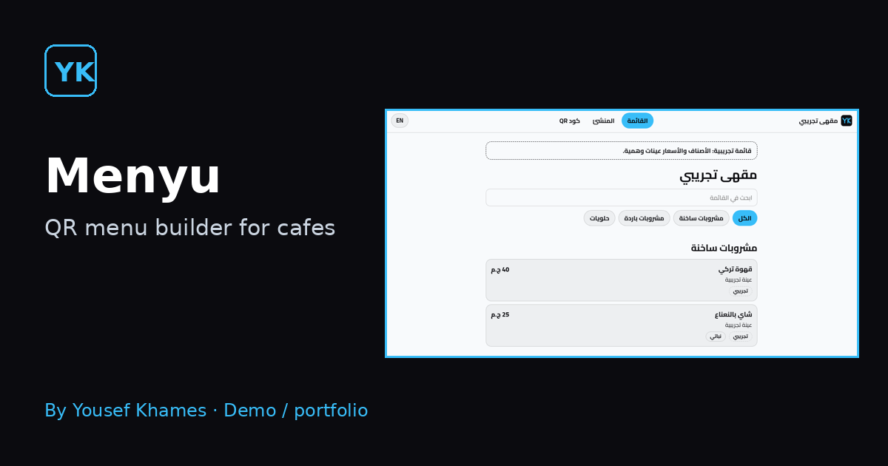

<div align="center">


# menyu

**menyu** · demo / portfolio project

**منشئ منيو QR للكافيهات** · مشروع تجريبي للعرض

[Live demo](https://yousefkhames.github.io/menyu/) · By Yousef Khames · من تطوير يوسف خميس



</div>

---

# menyu · منيو

A white-label QR menu builder for cafes: bilingual categories and items, tags, optional photos, a sold-out toggle, a published menu page and a printable QR table card. Arabic RTL and English LTR. Static HTML, CSS and JavaScript; no build, account, API or payment processor, and no ordering.

<div lang="ar" dir="rtl">أداة قوائم طعام بكود QR للمقاهي. عدّل القائمة، صدّر ملف menu-data.js، ثم انشره، واطبع بطاقة الطاولة. لا يوجد طلب أو دفع داخل الأداة.</div>

 **By Yousef Khames · من تطوير يوسف خميس**

## Preview locally

```sh
python3 -m http.server 8080 --bind 127.0.0.1
```

Open `http://localhost:8080/`. Use a fresh browser profile. The sample menu is **demo content** with fictional items and prices; it carries a Demo banner and every item has a Demo tag.

Screenshots in `docs/` show the demo menu (synthetic data). Re-take them after rebranding.

## Set up a cafe

1. Open **Builder** (`#/edit`). Set the shop name in both languages and the currency label. Add categories and items. Prices are optional: an item without a price shows "Ask for the price".
2. Press **Clear demo items** to remove the sample rows, then add your own.
3. Press **Export menu-data.js**, replace `menu-data.js` in the repository with the downloaded file, commit and publish. Builder edits are saved only in this browser (a draft); visitors see the published `menu-data.js` until you replace it. **Preview draft** shows the draft on your device.
4. Open **QR code**, paste the published page link, test-scan with a phone, then print the table card. The QR code is generated on your device with no internet. Links that start with localhost or a private address are flagged because guests cannot open them.
5. For static theming edit `assets/kit-theme.js` (`name`, optional `logo`, `accent`, `mode`, `light`, `dark`). Keep `assets/yk-logo.svg` and `assets/favicon.svg` for the developer credit.
6. Backup and move: **Export JSON backup** and **Import JSON** move a draft between devices. **Export single-file HTML** gives a one-file menu for hosts that accept files only. The menu schema (`v: 1`: shop, currency, categories, items) is shared with the matbakh kit.

## Deploy (GitHub Pages)

Create the repository `yousefkhames/menyu`, commit these files to `main`, then Settings → Pages → Deploy from a branch → `main` / root. The page appears at `https://yousefkhames.github.io/menyu/`. All paths are relative.

## Tests

```sh
npm run test:unit  # Node 22+, no install
npm run test:e2e   # headless Chrome available as google-chrome
npm test
```

## Honest limits and privacy

- Static and device-local: the draft does not sync between devices. Clearing site data erases the draft; export first.
- Photos are resized in the browser and embedded in the exported file as data; many photos make `menu-data.js` large.
- The QR code only links to the page. Nothing is counted: there are no scan or visit statistics.
- Prices and availability are what the owner typed; the sold-out toggle is manual.
- Contrast of the default theme pairs is checked; there is no blanket WCAG claim. Retest custom colours.
- No customer data is collected or stored.

## License

MIT, copyright Yousef Khames. See `LICENSE`. Bundled Cairo font keeps its own SIL OFL license; `assets/qrcode.js` is qrcode-generator by Kazuhiko Arase (MIT, see `assets/qrcode.LICENSE.txt`).
